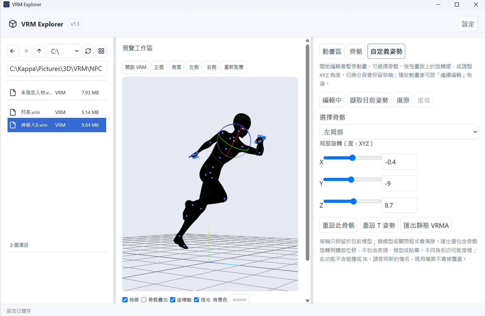

# VRM Explorer

Windows 桌面 VRM／VRMA／圖片素材瀏覽與預覽工具。以離線使用及可攜式為優先，原始素材唯讀；繁體中文預設，支援英文介面。

## 下載

- [v1.4.1 Offline 可攜版（Windows x64，約 302 MiB）](https://github.com/kappalien/VRMExplorer/releases/download/v1.4.1/VRM-Explorer-1.4.1-Offline-win-x64.zip)
- [SHA-256 校驗碼](https://github.com/kappalien/VRMExplorer/releases/download/v1.4.1/VRM-Explorer-1.4.1-Offline-win-x64.zip.sha256)
- [所有發行版本](https://github.com/kappalien/VRMExplorer/releases)

一般使用者請下載上面的 Offline ZIP。GitHub 的 **Code → Download ZIP** 是原始碼，不能直接啟動。

首次使用請下載 **v1.4.1 完整可攜版**，啟動後在「設定 → 線上更新」按「一鍵更新」取得最新版。最新版本、更新紀錄與版本說明請查看 [Release 頁面](https://github.com/kappalien/VRMExplorer/releases)。

目前發行目標為 **Windows 11 x64**。完整解壓後約 688 MiB，主要是隨附 Microsoft Fixed WebView2 Runtime 154.0.4258.62；使用程式不需安裝 Node.js、Rust 或 MSVC。

## 使用範例



左側瀏覽模型檔案，中央預覽角色；右側可切換動畫、骨骼及自定義姿勢分頁。圖中示範選擇左肩骨骼，以旋轉環與 XYZ 角度調整姿勢，並可匯出靜態 VRMA。

截圖由使用者提供，展示模型「神秘人B」不隨程式、原始碼或 Release 提供；模型權利仍屬原作者。[素材與第三方授權說明](docs/licensing.md)

## 快速開始

1. 將完整 ZIP 解壓至本機可寫入的資料夾。
2. 開啟其中的 `vrm-explorer.exe`。
3. 左側選擇磁碟或輸入資料夾路徑，雙擊資料夾進入，點選 `.vrm` 預覽。
4. 右側「選擇來源」選擇含 `.vrma` 的資料夾，掃描後點選檔名，再按「播放」。單幀靜態 VRMA 使用「套用姿勢」，可保持姿勢；「停止」會回復。

上次瀏覽資料夾、VRMA 來源與檢視方式會自動還原。請先閱讀包內 Microsoft Runtime 條款；使用與升級說明見 [Portable 發行文件](docs/portable-release.md)。

## 全部功能

| 功能           | 說明                                                                                                                                                                   |
| -------------- | ---------------------------------------------------------------------------------------------------------------------------------------------------------------------- |
| 支援素材       | VRM 0.x／1.0、VRMA，以及 PNG、JPG／JPEG、WebP、BMP 圖片。                                                                                                              |
| 檔案瀏覽       | 磁碟選擇、路徑輸入、資料夾導覽、上一個／下一個／上一層、重新整理；詳細資訊／縮圖／精簡檢視循環切換。詳細資訊顯示類型、大小與修改時間，上次瀏覽位置及檢視方式自動保存。 |
| 大型清單       | 虛擬化呈現，僅繪製可見項目；支援鍵盤移動與選取。                                                                                                                       |
| 模型預覽       | 滑鼠旋轉、平移、以游標為中心縮放；正面／背面／左右視角與重新取景。                                                                                                     |
| 場景選項       | 格線、骨骼疊加、座標軸、燈光與背景色。                                                                                                                                 |
| 模型資訊       | 顯示模型提供的名稱、作者、授權及網格／材質／貼圖／骨骼等資訊。                                                                                                         |
| 圖片預覽       | 直接檢視支援的圖片素材。                                                                                                                                               |
| 骨骼檢視       | 人形骨骼對應、模型節點、父節點、必要／選用狀態及缺少必要映射提示。                                                                                                     |
| 動畫來源       | VRMA 可與模型位於不同資料夾或磁碟；選擇來源後自動掃描，以檔名清單選取動作，保存來源偏好。                                                                              |
| 動畫播放       | 播放、暫停、停止、重播、循環、0.25×～2×速度與時間軸；單幀 VRMA 可套用並保持靜態姿勢。                                                                                  |
| 表情           | 跟隨動畫、自然、開心、生氣、悲傷、放鬆及驚訝；模型未提供的選項自動停用。                                                                                               |
| 自定義姿勢     | 分組選擇軀幹、四肢與手指；局部 XYZ 角度滑桿／數值、畫面骨骼控制點與旋轉環，以及髖部位移。                                                                              |
| 姿勢操作       | 擷取目前動畫姿勢、重設單骨骼或 T 姿勢、復原／重做；分頁切換保留草稿，播放動畫後可恢復編輯。                                                                            |
| 姿勢匯出       | 另存單幀靜態 `.vrma`，可重新載入套用；只包含骨骼姿勢，不夾帶模型或貼圖，不覆蓋既有檔案。                                                                               |
| 縮圖與快取     | 圖片縮圖、模型內嵌封面及背景頭部快照；設定快取容量、查看使用量與清除快取。                                                                                             |
| 語言與外觀     | 繁體中文預設、完整英文；淺色／深色／跟隨系統，可調整面板寬度。                                                                                                         |
| 系統設定       | 檔案大小單位（自動、B、KB／MB／GB、KiB／MiB／GiB）、應用版本與 WebView2 模式；記住視窗一般大小及最大化狀態。                                                           |
| 可攜使用       | 隨附離線 WebView2；設定、索引、快取及 WebView 資料寫於執行檔旁 `data/`，沒有 AppData fallback。                                                                        |
| 線上更新       | 一鍵檢查、下載、簽章驗證與重新啟動；程式及 Runtime 更新包分開，可取消下載，啟動失敗會嘗試回復舊版。                                                                    |
| 升級與素材保護 | 包含本機 `upgrade.ps1`，保留個人資料；原始素材唯讀，不載入外部 JavaScript 或 DLL Plugin。應用程式更新只採用簽章驗證的正式更新包。                                      |

### 使用限制

- VRM 優先顯示內嵌封面；沒有封面時，會依序在背景產生頭部快照並快取。首次需等待生成，無法解析或超過資源上限的模型保留檔案圖示。詳見 [縮圖快取說明](docs/thumbnail-cache.md)。
- 姿勢草稿於換模型或關閉程式時清除。匯出不包含表情、視線或物理模擬結果。
- 不同身形可能產生手掌交叉或穿模；目前不含 IK、碰撞、FBX／BVH／GLB 格式轉換或動畫錄製。
- `upgrade.ps1` 使用已下載且解壓的新版封裝，不會線上自動更新。

## 資料與升級

程式旁的 `data/` 包含個人設定、SQLite 索引與快取。移動可攜版時，保留整個資料夾即可保留資料。

升級前關閉程式並備份 `data/`；新包中的 `upgrade.ps1` 會驗證發行檔案、更新 EXE 與 Runtime，保留使用者資料。詳細步驟與 Microsoft 授權／隱私聲明見 [Portable 說明](docs/portable-release.md)。

公開倉庫與可攜包皆不包含使用者模型、動畫、資料庫或個人設定。模型與動畫的使用權由素材原始授權決定。

## 開發與建置

需要 Windows、Git、Node.js／npm、Rust MSVC 工具鏈，以及 Visual Studio C++ Build Tools／Windows SDK。以下為 PowerShell 指令：

```powershell
git clone https://github.com/kappalien/VRMExplorer.git
cd VRMExplorer
npm ci
npm run tauri dev
```

常用檢查：

```powershell
npm test
npm run lint
npm run build
cargo test --manifest-path src-tauri/Cargo.toml --locked
cargo clippy --manifest-path src-tauri/Cargo.toml --locked --all-targets -- -D warnings
```

建置與封裝：

```powershell
powershell -File scripts/fetch-runtime.ps1
powershell -File scripts/build.ps1
```

`fetch-runtime.ps1` 從 Microsoft 取得鎖定的 Fixed Runtime、核對 CAB 雜湊與簽章，並取得官方條款。`build.ps1` 執行測試、建置與封裝，輸出至本機 `releases/`。同版本 ZIP 已存在時，封裝會拒絕覆寫。

若只需 UI 檢視，可以使用 `npm run dev`；瀏覽器模式不提供 Portable 檔案存取或設定保存。

## 專案結構

| 路徑             | 用途                                             |
| ---------------- | ------------------------------------------------ |
| `src/`           | React／TypeScript 介面、預覽引擎與 i18n          |
| `src-tauri/src/` | Rust 檔案存取、Portable 設定、動畫索引與縮圖快取 |
| `scripts/`       | Runtime 取得、建置、封裝與升級                   |
| `tests/`         | 單元與 Edge 回歸測試                             |
| `docs/`          | 架構、使用、測試與開發記錄                       |

`node_modules/`、`src-tauri/target/`、`build/`、`releases/`、`data/` 與使用者 VRM／VRMA 不會進入 Git。原始碼、文件、截圖、第三方授權與 MPL 原始碼封存合計約 5.1 MiB；可攜 ZIP 另放 GitHub Release。

## 授權與署名 / Licensing

使用或再散布前請閱讀 [授權與素材說明](docs/licensing.md)。第三方授權及著作權聲明見 `licenses/third-party/`，MPL 元件原始碼見 `licenses/mpl-sources.zip`。Microsoft Runtime 與展示模型各有獨立條款。原創專案內容尚未指定開源授權；Public 不代表任意商用或再散布許可。

Third-party licenses, source availability and screenshot attribution are documented in [Licensing](docs/licensing.md). No general open-source license has been selected for original project content.

## English

VRM Explorer is a portable Windows desktop viewer for VRM avatars, VRMA animations and images. Download the full **v1.4.1 Offline package**, extract it into a writable local folder and run `vrm-explorer.exe`. Use **Settings → Online updates** to get the latest version. Fixed WebView2 is included; routine app updates exclude unchanged Runtime files. Original assets are read-only, and personal settings, indexes, cache and window preferences stay in `data/` beside the executable.

Browse files in Details, Thumbnails or Compact view, preview avatars and images, play animations, inspect skeletons, edit custom poses and export static VRMA files. The interface supports Traditional Chinese and English. See the [Pose guide](docs/v1.3-pose.md) for editing instructions and [GitHub Releases](https://github.com/kappalien/VRMExplorer/releases) for version history and release notes.

依根目錄 [開發規格](VRM_Explorer_Codex_Development_Spec.md) 開發。
